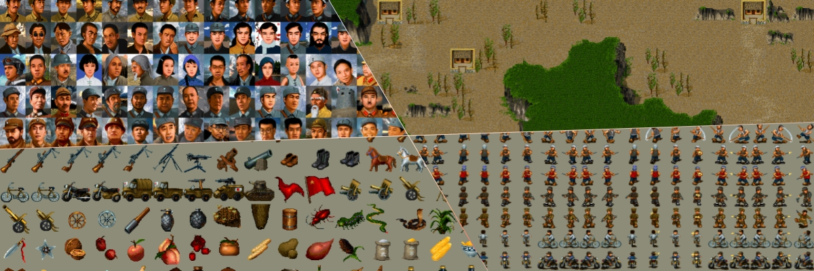

# dlz_research


Contains a collection of one-off scripts to extract data and graphics from the game **抗日之地雷战** (Landmine War, 1998).

## 复刻版本 (dlzr)

完整的 C++ 重制版，位于 `dlzr/` 目录。

**特性：**
- 二进制兼容：直接读取原始 DAT 文件，存档格式与原版完全兼容（28 blocks × 85072 bytes）
- SDL3 渲染：支持触摸/手柄输入、整数缩放、多分辨率适配
- 完整游戏系统：战斗、对话、装备、锻造、转职、隐藏关卡、多结局
- 跨平台：Windows 原生 + Web (Emscripten)

**构建：**
```bash
cd dlzr
cmake -B build -G "Visual Studio 17 2022"
cmake --build build --config Debug
```

详细文档见 `dlzr/README.md` 和 `dlzr/docs/`。
